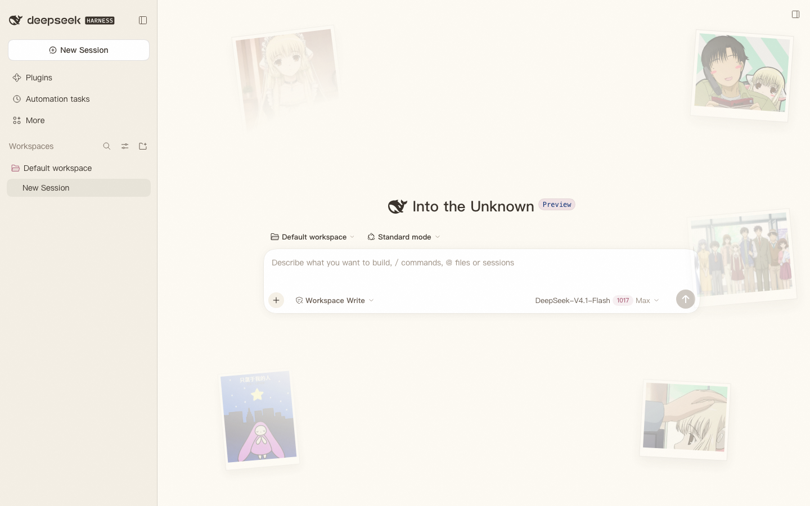
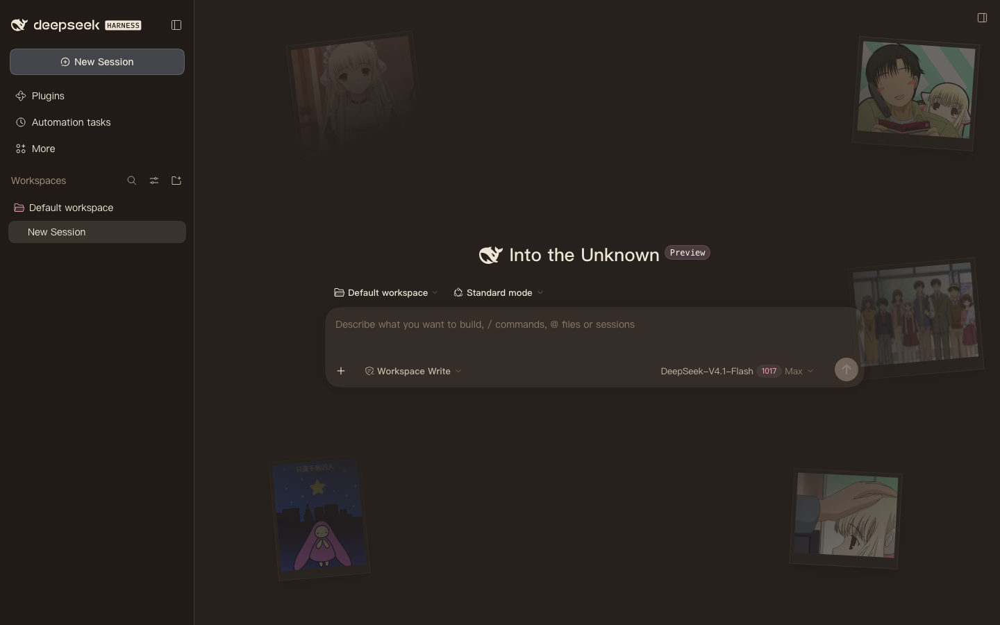

<div align="center">
  <h1>Chobits-Chii-DSH</h1>
  <p><b>Chii~</b> A Chii-themed picture-book skin for the DeepSeek Harness web UI</p>
  <p>A Chii-themed skin plugin for the DeepSeek Harness web UI.</p>
  <p>
    <a href="https://github.com/Anime2Real/Chobits-Chii-DSH"></a>
    <a href="https://www.npmjs.com/package/chobits-chii-dsh"></a>
    <a href="LICENSE"></a>
    <a href="https://github.com/topics/dsh-plugin"></a>
    <a href="https://github.com/deepseek-ai/deepseek-harness"></a>
  </p>
  <p>
    <a href="./README.md">简体中文</a> ｜ <a href="./README.ja.md">日本語</a> ｜ <a href="./README.en.md">English</a>
  </p>
</div>

<p align="center">
  
  
</p>

> ⚠️ **Code is MIT, assets are not.** Chobits and its characters are copyright CLAMP and the relevant rights holders. The code of this project is released under the [MIT License](./LICENSE); the illustrations and Live2D model are © Anime2Real and may only be used as part of this plugin, unmodified, for non-commercial purposes — see [ASSETS.md](./ASSETS.md).

## ✨ Features

- **Neutral warm palette**: warm cream base, warm ink text and low-saturation rose accents, with light and dark token sets (the palette comes from the [Chobits-Chii-Mascot-Release](https://github.com/Anime2Real/Chobits-Chii-Mascot-Release) landing page, toned down toward a more neutral direction)
- **Polaroid photo wall**: the same five illustrations as the landing page, made into portrait and landscape Polaroid patches scattered around the edges of the UI and fading toward the center; the 300px sidebar column and the content area are never covered, and edge photos hide automatically in narrow windows
- **Subtle motion**: photos parallax in opposite directions by depth on pointer move, and drift very slowly on their own; automatically off under `prefers-reduced-motion`, and parallax is disabled on touch devices
- **Detail work**: rounded font stack, rose selection color, picture-book noise texture, warm background glow
- **Live2D Chii mascot**: Chii lives in the bottom-right corner (on by default; toggle it in **Plugins → chobits-chii-dsh** and the choice is remembered), and follows the pointer with her gaze; she switches to `Look` while a session is running and back to `Idle` when idle; the model is a slimmed-down web build with 1024 textures (about 2.5 MB), bundled with the package and available offline, quietly falling back to the photo wall when WebGL is missing or loading fails (clicks pass through, and there are no tap-triggered actions)
- **Client-only, build-free install**: `lib/client.js` is committed, so it works right after `dsh plugin add`; illustrations are inlined as data URIs at build time, and the Live2D runtime and model are served by a read-only host-side route
- **Hot-uninstallable**: all style and DOM injection goes through `ctx.effect`, so disabling or uninstalling the plugin restores everything

## 🚀 Install

Requires DeepSeek Harness (`dsh --version` prints something) and at least one `dsh web` run:

```sh
# npm (recommended)
dsh plugin --profile web add chobits-chii-dsh

# GitHub source (fallback)
dsh plugin --profile web add github:Anime2Real/Chobits-Chii-DSH
```

Restart `dsh web` after installing (or refresh the page). To uninstall:

```sh
dsh plugin --profile web remove chobits-chii-dsh
```

### Finding it in Discover

Plugins → Discover in DSH only shows index sources you added yourself. Open **Plugins → Experimental plugins → Custom plugin indexes**, then add this under **Discover → Add index source**:

```
https://anime2real.github.io/Chobits-Chii-DSH/market/index.json
```

Then search for "Chii" and install with one click. The index file is [`market/index.json`](./market/index.json) in DSH's format 1; the generator prefers the npm source and falls back to the git commit when the version is not published yet.

Local development install (from the repository directory, linked into the profile):

```sh
dsh plugin --profile web add ./
```

## 🧩 Compatibility

| Item | Value |
| --- | --- |
| `engines.dsh` | `>=0.2.1-rc.5 <0.3.0` |
| Dark selector | `body[data-ds-dark-theme]` |
| Token source | design-platform styles built into `@deepseek-ai/dsh-client-ui-theme@0.2.1-rc.5` |

DSH is a developer preview: if a token name or client plugin contract changes after an upgrade, the skin may break — update `src/tokens.js` and `engines.dsh` in `package.json` when that happens. The style layer also has `body`-level token fallback rules, so most of the look survives even when the theme service is unavailable.

## 🔧 How it works

A client-only plugin: it declares `inject: ['theme']` on the returned object, and the runtime applies it once the theme service is ready:

1. **Theme service channel** (primary): `theme.overrideTokens('chobits-chii', aliases)` registers light and dark overrides for 66 `--dsw-*` tokens (`src/tokens.js`), applied instantly when the DSH appearance switches and cleaned up on the fly. The DSH theme renderer writes tokens as inline styles on `<body>`, which is the only channel that can outrank the built-in defaults.
2. **Style layer**: injects styles into `<head>` with a `data-plugin-css` dedupe marker, carrying the fonts, selection color, noise, glow and photo wall (`src/skin.css`); the token variable rules are also attached to `body` as a secondary safeguard when the renderer is absent
3. **Photo wall**: driven by the `WALL` array in `src/client.template.js`; five 520px jpgs (`assets/wall-*.jpg`, about 250KB in total) are inlined as data URIs at build time; portrait images are 4:5 and landscape ones 5:4, with a two-layer mask (a radial fade toward the center plus a left-hand strip) to keep things readable
4. **Live2D mascot**: `src/live2d.js` (inlined into `lib/client.js` at build time) loads pixi / Cubism Core / the model from `assets/live2d/` while idle after first paint, and mounts a click-through canvas in the bottom-right corner; the host half (`lib/index.js`) mounts that directory as a read-only route `/chii-live2d/assets` with `ctx.webServer.register`, so the model never enters the client bundle and needs no external CDN

## 🎨 Customize

- **Colors**: edit the token values in `src/tokens.js` (light and dark in pairs), then rebuild
- **Photo wall**: edit the `WALL` array in `src/client.template.js` (`left` / `right` plus `y` / `bottom` control the anchor, `depth` the parallax depth, `portrait` portrait vs landscape, `wide` / `tallOnly` visibility in narrow windows, `r` rotation, `s` scale); to swap an image, drop the file into `assets/`
- **Fade range and opacity**: `.chobits-chii-wall` in `src/skin.css`
- **Mascot toggle**: the **Plugins → chobits-chii-dsh** config page has a **Chii mascot** toggle (registered under `plugins.bundle.config`); it applies instantly with no refresh, and the mascot has no close button on it — you can turn it back on there at any time (the preference lives in `localStorage` under `chobits-chii-dsh:live2d`); while the mascot is present, the bottom-right `wall-chii-headpat` photo is **hidden outright**, and comes back to its place when you turn the mascot off (the `body[data-chii-mascot]` rule in `src/skin.css`)

After editing, run `node scripts/build.mjs`, restart `dsh web` and refresh the page.

## 🛠 Development

```sh
node scripts/build.mjs        # src/ + assets/ → lib/client.js (plain JS, committed, so installs need no build)
node scripts/smoke.mjs        # browser-less smoke test: ModuleLoader contract / environments with and without a theme service
node scripts/market-index.mjs # regenerate market/index.json after a release (npm source first, current commit as fallback)
```

Directory layout:

```
package.json           # dsh.client manifest + dsh.bundle.patch + engines.dsh
cordis.patch.yml       # inserts the ui-chobits-chii row into the web profile roster
lib/index.js           # host half: mounts assets/live2d/ as the read-only route /chii-live2d/assets
lib/client.js          # browser half (build output, committed)
src/client.template.js # template for lib/client.js (placeholders replaced by build)
src/live2d.js          # Live2D mascot controller (inlined at build time)
src/tokens.js          # light and dark --dsw-* token sets
src/skin.css           # decoration layer (fonts/noise/photo wall/mascot), supports asset("name") references
assets/                # 5 jpg illustrations (inlined at build time)
assets/live2d/         # web slim model (2.5 MB) + runtime libs + Core (served by the route, not bundled)
docs/                  # README preview screenshots, Live2D design doc
market/index.json      # Discover index (format 1)
market/awesome/        # awesome-dsh-plugin submission entry
scripts/build.mjs      # build script (Node built-ins only, zero dependencies)
scripts/smoke.mjs      # smoke test
scripts/market-index.mjs # generates the Discover index
```

## 🗺 Roadmap

- **v0.1**: skin MVP — dual-token themes + fonts/noise
- **v0.2**: Polaroid photo wall background (fading toward the center)
- **v0.3**: neutral palette + portrait/landscape Polaroids + sidebar/content avoidance (landing-page five images only)
- **v1.0**: Live2D Chii mascot — bundled web slim model, bottom-right corner, gaze following, `running → Look` / idle → `Idle`, Plugins page toggle
- **v1.0.1**: Live2D textures moved to 1024×1024 (2.5 MB model), re-exported from the runtime source model
- **v1.0.2 (current)**: English and Japanese READMEs with a language switcher; package description in Chinese, Japanese and English
- **v1.1**: more state triggers (approval → alert, turn done / failed → expressions), draggable mascot, scale setting
- **v1.2**: accessibility and performance pass (1024 texture variant done)

## 🏠 About Anime2Real

[Anime2Real](https://github.com/Anime2Real) is a group of developers who turn "anime characters" into things that actually run: desktop mascots, speech, Live2D, 3D, dialogue models — all the way from asset production to installable products, all open source. Chii is our first character, and this skin is just one place she lives inside DeepSeek Harness.

- Organization: [github.com/Anime2Real](https://github.com/Anime2Real)
- Want to see Chii come alive on your desktop: [Chobits-Chii-Mascot](https://github.com/Anime2Real/Chobits-Chii-Mascot) / [release page](https://anime2real.github.io/Chobits-Chii-Mascot-Release/)
- Want to give her a voice: [Chobits-Chii-TTS](https://github.com/Anime2Real/Chobits-Chii-TTS) · [Chobits-Chii-ASR](https://github.com/Anime2Real/Chobits-Chii-ASR)
- Want to see how the model is made: [Chobits-Chii-Live2D](https://github.com/Anime2Real/Chobits-Chii-Live2D)
- Want to join in: issues are open on every repository — ideas, bug reports and PRs are welcome; a star also helps more people find us

## 🔗 The Chii family

| Project | Description |
| --- | --- |
| [Chobits-Chii-Mascot](https://github.com/Anime2Real/Chobits-Chii-Mascot) | Desktop mascot client (Electron + Live2D; the model source for the second stage of this plugin) |
| [Chobits-Chii-Mascot-Release](https://github.com/Anime2Real/Chobits-Chii-Mascot-Release) | Public release channel and [product page](https://anime2real.github.io/Chobits-Chii-Mascot-Release/) for the desktop mascot (the source of the palette and illustrations) |
| [Chobits-Chii-TTS](https://github.com/Anime2Real/Chobits-Chii-TTS) | Chii speech synthesis model |
| [Chobits-Chii-ASR](https://github.com/Anime2Real/Chobits-Chii-ASR) | Chii speech recognition service |
| [Chobits-Chii-LLM](https://github.com/Anime2Real/Chobits-Chii-LLM) | Chii Japanese dialogue LLM |
| [Chobits-Chii-Live2D](https://github.com/Anime2Real/Chobits-Chii-Live2D) | Chii Live2D models and motion assets |

## 📄 License

**Code is released under [MIT](./LICENSE); assets are not.** Open-source code is not open-source assets —

- **Code** (`src/`, `lib/client.js`, `lib/index.js`, `scripts/`, `cordis.patch.yml`): MIT
- **Assets** (the five illustrations in `assets/`, the models and runtime libs in `assets/live2d/`, the preview images in `docs/`): © Anime2Real, all rights reserved; they may only be used as part of this plugin, unmodified, for non-commercial purposes, and may not be extracted or redistributed on their own. See [ASSETS.md](./ASSETS.md) for the full terms
- **Character likeness** (Chii from *Chobits*): copyright CLAMP and the relevant rights holders; Anime2Real neither claims nor can grant those rights
- **Third-party components**: `live2dcubismcore.min.js` (Live2D Cubism Core) is distributed under the [Live2D Proprietary Software License](https://www.live2d.com/eula/live2d-proprietary-software-license-agreement_en.html) (the official `RedistributableFiles.txt` list permits redistribution); the license text is in `LICENSE-Live2D-Core.md` next to it; `pixi.min.js` / `live2d.min.js` / `pixi-live2d-display.min.js` are MIT — see [NOTICE](./NOTICE)
- **Model source**: `assets/live2d/chii.model3.json` and friends are the slimmed-down web build exported by `pipeline/export-web.mjs` in [Chobits-Chii-Live2D](https://github.com/Anime2Real/Chobits-Chii-Live2D) from the live runtime model (1024 texture WebP); the source and sizes are recorded in `SOURCE.md` in the same directory

> Note: GitHub's license detection only looks at `LICENSE`, so the repository page still shows MIT — the asset terms in this README and [ASSETS.md](./ASSETS.md) govern.
