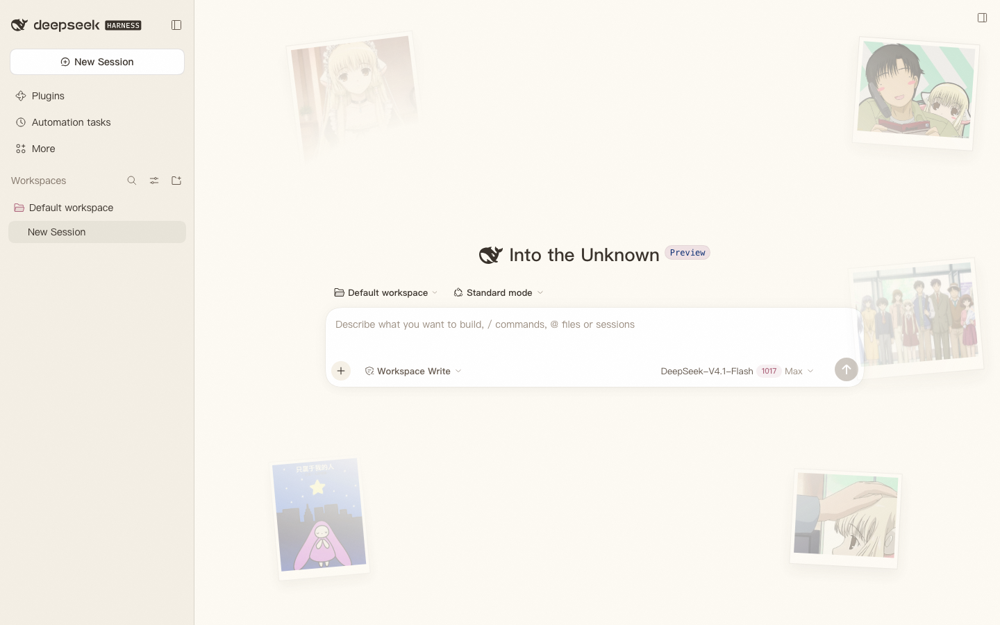
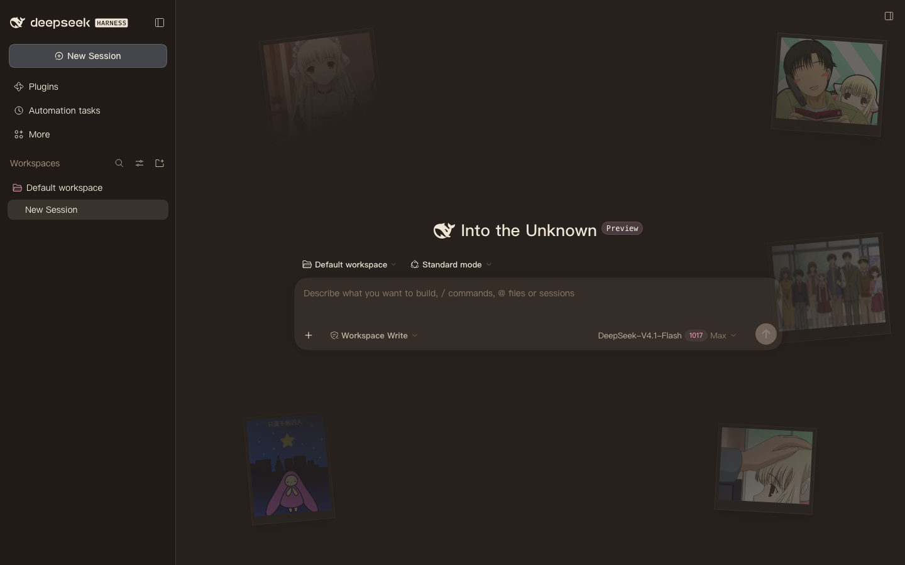

<div align="center">
  <h1>Chobits-Chii-DSH</h1>
  <p><b>ちぃ～</b> DeepSeek Harness の Web UI をちぃの絵本風スキンに</p>
  <p>DeepSeek Harness の Web UI 向けちぃ柄スキンプラグインです。</p>
  <p>
    <a href="https://github.com/Anime2Real/Chobits-Chii-DSH"></a>
    <a href="https://www.npmjs.com/package/chobits-chii-dsh"></a>
    <a href="LICENSE"></a>
    <a href="https://github.com/topics/dsh-plugin"></a>
    <a href="https://github.com/deepseek-ai/deepseek-harness"></a>
  </p>
  <p>
    <a href="./README.md">简体中文</a> ｜ <a href="./README.ja.md">日本語</a> ｜ <a href="./README.en.md">English</a>
  </p>
</div>

<p align="center">
  
  
</p>

> ⚠️ **コードは MIT、アセットは別扱いです。** Chobits およびそのキャラクターの著作権は CLAMP ならびに権利者に帰属します。本プロジェクトのコードは [MIT ライセンス](./LICENSE) で公開していますが、イラストと Live2D モデルは © Anime2Real であり、本プラグインの一部として、改変せず、非商用に限って使用できます——詳細は [ASSETS.md](./ASSETS.md) をご覧ください。

## ✨ 機能

- **ニュートラルな暖色パレット**:暖かいクリーム色の下地 + 暖かいインク色の文字 + 低彩度のローズ系アクセント。ライト / ダークの 2 セットのトークン([Chobits-Chii-Mascot-Release](https://github.com/Anime2Real/Chobits-Chii-Mascot-Release) のランディングページから採り、ニュートラル寄りに調整)
- **ポラロイド写真ウォール**:ランディングページと同じ 5 枚のイラストを縦横のポラロイド風に加工し、UI の周囲に散らして中央に向かってフェード。左側 300px のサイドバー領域と本文領域は決して覆わず、狭いウィンドウでは端の写真を自動的に隠します
- **さりげない動き**:ポインターの移動に合わせて写真がそれぞれの奥行きに応じて逆方向にパララックスし、写真自体もごくゆっくりと漂います。`prefers-reduced-motion` では自動的にオフ、タッチ端末ではパララックスを無効にします
- **細部の装飾**:丸ゴシック系のフォント、ローズ色の選択状態、絵本風のノイズテクスチャ、暖色の背景グロー
- **Live2D ちぃマスコット**:右下に常駐するちぃ(初期状態はオン。**Plugins → chobits-chii-dsh** の設定ページで切り替えでき、選択は記憶されます)。ポインターを視線で追い、セッション実行中は `Look`、アイドル時は `Idle` に切り替わります。モデルは 1024 テクスチャの WebP に軽量化した版(約 2.5 MB)で、パッケージに同梱されオフラインでも動作し、WebGL がない場合や読み込みに失敗した場合は静かに写真ウォールにフォールバックします(クリックは透過し、クリックで動作を起こすことはありません)
- **クライアントのみ・ビルド不要のインストール**:`lib/client.js` をリポジトリにコミット済みのため、`dsh plugin add` の直後から使えます。イラストはビルド時に data URI としてインライン化され、Live2D ランタイムとモデルは host 側の読み取り専用ルートで配信されます
- **ホットアンインストール可能**:スタイルと DOM の注入はすべて `ctx.effect` を通すため、プラグインを無効化 / アンインストールすれば完全に元に戻ります

## 🚀 インストール

DeepSeek Harness がインストール済み(`dsh --version` が出力される)で、一度以上 `dsh web` を起動している必要があります:

```sh
# npm(推奨)
dsh plugin --profile web add chobits-chii-dsh

# GitHub ソース(予備)
dsh plugin --profile web add github:Anime2Real/Chobits-Chii-DSH
```

インストール後に `dsh web` を再起動してください(またはページを再読み込み)。アンインストール:

```sh
dsh plugin --profile web remove chobits-chii-dsh
```

### Discover で見つける

DSH の Plugins → Discover には、自分で追加したインデックスソースだけが表示されます。**Plugins → Experimental plugins → Custom plugin indexes** を開き、**Discover → Add index source** に次を追加してください:

```
https://anime2real.github.io/Chobits-Chii-DSH/market/index.json
```

あとは "Chii" で検索すればワンクリックでインストールできます。インデックスファイルは [`market/index.json`](./market/index.json) で、DSH の format 1 形式です。生成スクリプトは npm ソースを優先し、未公開のときは git のコミットにフォールバックします。

ローカル開発用のインストール(リポジトリのディレクトリで、link 方式でプロファイルに追加):

```sh
dsh plugin --profile web add ./
```

## 🧩 互換性

| 項目 | 値 |
| --- | --- |
| `engines.dsh` | `>=0.2.1-rc.5 <0.3.0` |
| ダークセレクター | `body[data-ds-dark-theme]` |
| トークン名の由来 | `@deepseek-ai/dsh-client-ui-theme@0.2.1-rc.5` に組み込まれたデザインプラットフォームのスタイル |

DSH は developer preview です。アップグレードでトークン名やクライアントプラグインの契約が変わるとスキンが動かなくなる可能性があります。その際は `src/tokens.js` と `package.json` の `engines.dsh` を更新してください。スタイル層には `body` レベルのトークンフォールバック規則もあるため、theme サービスが使えなくても見た目の大半は保たれます。

## 🔧 仕組み

クライアントのみ(client-only)のプラグインで、返すオブジェクトに `inject: ['theme']` を宣言し、theme サービスの準備ができた時点でランタイムが適用します:

1. **theme サービス経由**(主経路):`theme.overrideTokens('chobits-chii', aliases)` で 66 個の `--dsw-*` トークンのライト / ダーク両方の上書きを登録(`src/tokens.js`)し、DSH の外観切り替えに即座に追従、ホットクリーンアップも可能です。DSH のテーマレンダラーはトークンを `<body>` のインラインスタイルに書き込むため、組み込みの既定値を上回れるのはこの経路だけです
2. **スタイル層**:`<head>` に `data-plugin-css` の重複除去マーカー付きでスタイルを注入し、フォント・選択状態・ノイズ・グロー・写真ウォールを担います(`src/skin.css`)。トークン変数の規則は `body` にも付与し、レンダラーがない場合の二次的な保護としています
3. **写真ウォール**:`src/client.template.js` の `WALL` 配列で駆動します。5 枚の 520px jpg(`assets/wall-*.jpg`、合計約 250KB)をビルド時に data URI としてインライン化。縦 4:5、横 5:4 で、二層マスク(中央へのラジアルフェード + 左側の帯)で可読性を確保します
4. **Live2D マスコット**:`src/live2d.js`(ビルド時に `lib/client.js` へインライン化)が初回描画後のアイドル時に `assets/live2d/` の pixi / Cubism Core / モデルを読み込み、右下にクリック透過の canvas を配置します。host 側(`lib/index.js`)は `ctx.webServer.register` でそのディレクトリを読み取り専用ルート `/chii-live2d/assets` として公開するため、モデルはクライアントバンドルに入らず、外部 CDN にも依存しません

## 🎨 カスタマイズ

- **配色**:`src/tokens.js` のトークン値(ライト / ダークを対で)を変更して再ビルド
- **写真ウォール**:`src/client.template.js` の `WALL` 配列を編集(`left` / `right` と `y` / `bottom` がアンカー、`depth` がパララックスの奥行き、`portrait` が縦横、`wide` / `tallOnly` が狭いウィンドウでの表示、`r` が回転、`s` が拡大率)。画像を差し替えるには `assets/` にファイルを置くだけです
- **フェード範囲と透明度**:`src/skin.css` の `.chobits-chii-wall`
- **マスコットのオン / オフ**:サイドバーの **Plugins → chobits-chii-dsh** 設定ページに **ちぃマスコット** の切り替えがあります(`plugins.bundle.config` に登録)。切り替えは即時反映で再読み込み不要。マスコット本体に閉じるボタンはなく、オフにしてもいつでもそこで戻せます(設定は `localStorage` の `chobits-chii-dsh:live2d` に保存)。マスコットがいる間、右下の `wall-chii-headpat` の写真は**そのまま非表示**になり、オフにすると元の位置に戻ります(`src/skin.css` の `body[data-chii-mascot]` の規則)

変更後は `node scripts/build.mjs` を実行し、`dsh web` を再起動してページを再読み込みしてください。

## 🛠 開発

```sh
node scripts/build.mjs        # src/ + assets/ → lib/client.js(純 JS、リポジトリにコミット、インストール時にビルド不要)
node scripts/smoke.mjs        # ブラウザなしのスモークテスト:ModuleLoader の契約 / theme サービスあり・なしの 2 環境
node scripts/market-index.mjs # リリース後に market/index.json を再生成(npm ソース優先、未公開時は現在のコミット)
```

ディレクトリ構成:

```
package.json           # dsh.client マニフェスト + dsh.bundle.patch + engines.dsh
cordis.patch.yml       # web プロファイルのロスターに ui-chobits-chii 行を挿入
lib/index.js           # host 側:assets/live2d/ を読み取り専用ルート /chii-live2d/assets として公開
lib/client.js          # ブラウザ側(ビルド成果物、コミット済み)
src/client.template.js # lib/client.js のテンプレート(プレースホルダーは build が置換)
src/live2d.js          # Live2D マスコットのコントローラー(ビルド時にインライン化)
src/tokens.js          # ライト / ダークの --dsw-* トークン集
src/skin.css           # 装飾レイヤー(フォント/ノイズ/写真ウォール/マスコット)、asset("name") 参照に対応
assets/                # jpg イラスト 5 枚(ビルド時にインライン化)
assets/live2d/         # Web 軽量モデル(2.5 MB)+ ランタイムライブラリ + Core(ルート配信、バンドルには含めない)
docs/                  # README 用プレビュー画像、Live2D 設計ドキュメント
market/index.json      # Discover インデックス(format 1)
market/awesome/        # awesome-dsh-plugin 投稿エントリー
scripts/build.mjs      # ビルドスクリプト(Node 標準 API のみ、依存ゼロ)
scripts/smoke.mjs      # スモークテスト
scripts/market-index.mjs # Discover インデックスの生成
```

## 🗺 ロードマップ

- **v0.1**:スキン MVP —— トークン 2 テーマ + フォント/ノイズ
- **v0.2**:ポラロイド写真ウォール背景(中央に向かってフェード)
- **v0.3**:ニュートラル配色 + 縦横ポラロイド + サイドバー/本文の回避(ランディングページの 5 枚のみ使用)
- **v1.0**:Live2D ちぃマスコット —— 軽量 Web モデル同梱、右下に常駐、視線追従、`running → Look` / アイドル → `Idle`、Plugins ページの切り替え
- **v1.0.1(現在)**:Live2D テクスチャを 1024×1024 に変更(モデル 2.5 MB)、ランタイムソースモデルから再エクスポート
- **v1.1**:さらなる状態連動(承認 → 警戒、完了 / 失敗 → 表情)、マスコットのドラッグ、拡大率の設定項目
- **v1.2**:アクセシビリティとパフォーマンスの点検(1024 テクスチャ版は対応済み)

## 🏠 Anime2Real について

[Anime2Real](https://github.com/Anime2Real) は、「アニメのキャラクター」を実際に動くものにする開発者たちの集まりです。デスクトップマスコット、音声、Live2D、3D、対話モデルまで、素材制作からインストールできる製品まで一貫して手がけ、すべてオープンソースで公開しています。ちぃは私たちの最初のキャラクターで、このスキンは彼女が DeepSeek Harness の中に住む場所のひとつです。

- 組織ページ:[github.com/Anime2Real](https://github.com/Anime2Real)
- ちぃをデスクトップで動かしたい:[Chobits-Chii-Mascot](https://github.com/Anime2Real/Chobits-Chii-Mascot) / [配布ページ](https://anime2real.github.io/Chobits-Chii-Mascot-Release/)
- 声をあげたい:[Chobits-Chii-TTS](https://github.com/Anime2Real/Chobits-Chii-TTS) · [Chobits-Chii-ASR](https://github.com/Anime2Real/Chobits-Chii-ASR)
- モデルの作り方を見たい:[Chobits-Chii-Live2D](https://github.com/Anime2Real/Chobits-Chii-Live2D)
- 参加したい:各リポジトリの issue は常に開いています。アイデア、不具合報告、PR を歓迎します。Star を付けていただけると、より多くの人に見つけてもらえます

## 🔗 ちぃファミリー

| プロジェクト | 説明 |
| --- | --- |
| [Chobits-Chii-Mascot](https://github.com/Anime2Real/Chobits-Chii-Mascot) | デスクトップマスコットクライアント(Electron + Live2D、本プラグイン第 2 段階のモデル提供元) |
| [Chobits-Chii-Mascot-Release](https://github.com/Anime2Real/Chobits-Chii-Mascot-Release) | デスクトップマスコットの公開配布チャンネルと[製品ページ](https://anime2real.github.io/Chobits-Chii-Mascot-Release/)(配色とイラストの提供元) |
| [Chobits-Chii-TTS](https://github.com/Anime2Real/Chobits-Chii-TTS) | ちぃ音声合成モデル |
| [Chobits-Chii-ASR](https://github.com/Anime2Real/Chobits-Chii-ASR) | ちぃ音声認識サービス |
| [Chobits-Chii-LLM](https://github.com/Anime2Real/Chobits-Chii-LLM) | ちぃ日本語対話 LLM |
| [Chobits-Chii-Live2D](https://github.com/Anime2Real/Chobits-Chii-Live2D) | ちぃの Live2D モデルとモーションアセット |

## 📄 ライセンス

**コードは [MIT](./LICENSE)、アセットは MIT の対象外です。** コードのオープンソースは素材のオープンソースではありません——

- **コード**(`src/`、`lib/client.js`、`lib/index.js`、`scripts/`、`cordis.patch.yml`):MIT
- **アセット**(`assets/` のイラスト 5 枚、`assets/live2d/` のモデルとランタイムライブラリ、`docs/` のプレビュー画像):© Anime2Real、全権利保留。本プラグインの一部として、改変せず、非商用に限って使用でき、単独での抽出や再配布はできません。詳細は [ASSETS.md](./ASSETS.md) をご覧ください
- **キャラクター形象**(ちぃ / Chii、「ちょびっツ」)の著作権は CLAMP ならびに権利者に帰属します。Anime2Real はこれらの権利を主張せず、許諾することもできません
- **サードパーティコンポーネント**:`live2dcubismcore.min.js`(Live2D Cubism Core)は [Live2D Proprietary Software License](https://www.live2d.com/eula/live2d-proprietary-software-license-agreement_en.html) に基づきパッケージに同梱しています(公式の `RedistributableFiles.txt` リストが再配布を許可)。ライセンス全文は同ディレクトリの `LICENSE-Live2D-Core.md` にあります。`pixi.min.js` / `live2d.min.js` / `pixi-live2d-display.min.js` は MIT——まとめは [NOTICE](./NOTICE) をご覧ください
- **モデルの出所**:`assets/live2d/chii.model3.json` などは、[Chobits-Chii-Live2D](https://github.com/Anime2Real/Chobits-Chii-Live2D) の `pipeline/export-web.mjs` が現行ランタイムモデルからエクスポートした Web 軽量版(1024 テクスチャ WebP)です。出所とサイズは同ディレクトリの `SOURCE.md` に記録しています

> 補足:GitHub のライセンス判定は `LICENSE` のみを見るため、リポジトリページには MIT と表示されます——アセットの条件は本 README と [ASSETS.md](./ASSETS.md) が優先します。
