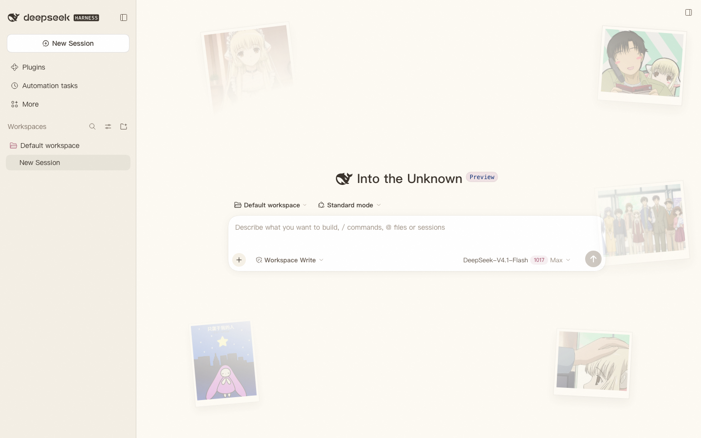
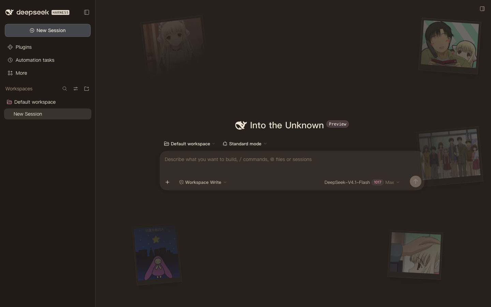

<div align="center">
  <h1>Chobits-Chii-DSH</h1>
  <p><b>叽～</b> 把 DeepSeek Harness 换成小叽的绘本风皮肤</p>
  <p>A Chii-themed skin plugin for the DeepSeek Harness web UI.</p>
  <p>
    <a href="https://github.com/Anime2Real/Chobits-Chii-DSH"></a>
    <a href="https://www.npmjs.com/package/chobits-chii-dsh"></a>
    <a href="LICENSE"></a>
    <a href="https://github.com/topics/dsh-plugin"></a>
    <a href="https://github.com/deepseek-ai/deepseek-harness"></a>
  </p>
</div>

<p align="center">
  
  
</p>

> ⚠️ **代码 MIT,资产另计。** Chobits 及其角色的版权归 CLAMP 及相关权利方所有;本项目代码以 [MIT 许可证](./LICENSE) 发布,插画与 Live2D 模型 © Anime2Real,只允许作为本插件的一部分、原样、非商业使用——详见 [ASSETS.md](./ASSETS.md)。

## ✨ 功能特性

- **中性暖调配色**:暖奶油底 + 暖墨文字 + 低饱和玫瑰点缀,浅色 / 深色两套 token(色板取自 [Chobits-Chii-Mascot-Release](https://github.com/Anime2Real/Chobits-Chii-Mascot-Release) 落地页,并按中性化取向收敛)
- **拍立得照片墙**:落地页同款 5 张插画做成横 / 竖拍立得贴片,沿界面四周散布、向中心渐隐;左侧 300px 侧边栏区与正文区永不遮挡,窄窗口自动隐藏边缘照片
- **轻微动态**:鼠标移动时照片按各自深度做反向视差,照片本身有极慢的漂浮;`prefers-reduced-motion` 下自动关闭,触屏不启用视差
- **细节装饰**:圆体字族、玫瑰色选中态、绘本噪点纹理、暖调背景光斑
- **Live2D 小叽桌宠**:右下角常驻的小叽(可在 **Plugins → chobits-chii-dsh** 的配置页里开关,记住选择),视线跟随鼠标;会话开始跑时切到 `Look`、空闲回到 `Idle`;模型是 2048 贴图 WebP 的精简版(约 2.7 MB),随包内置、离线可用,无 WebGL 或加载失败时安静退回照片墙(点击穿透,不做点击触发动作)
- **纯客户端、免构建安装**:`lib/client.js` 已随仓库提交,`dsh plugin add` 后即可用;配图构建期内联为 data URI,Live2D 运行时与模型由 host 半的只读路由伺服
- **可热卸载**:一切样式与 DOM 注入都走 `ctx.effect`,禁用 / 卸载插件即完全还原

## 🚀 安装

要求已安装 DeepSeek Harness(`dsh --version` 有输出),并至少启动过一次 `dsh web`:

```sh
# npm(推荐)
dsh plugin --profile web add chobits-chii-dsh

# GitHub 源(备用)
dsh plugin --profile web add github:Anime2Real/Chobits-Chii-DSH
```

安装后重启 `dsh web`(或刷新页面)。卸载:

```sh
dsh plugin --profile web remove chobits-chii-dsh
```

### 在 Discover 中发现

DSH 的 Plugins → Discover 只显示用户自己添加的索引源。打开 **Plugins → Experimental plugins → Custom plugin indexes**,在 **Discover → Add index source** 里加入:

```
https://anime2real.github.io/Chobits-Chii-DSH/market/index.json
```

然后搜索 "Chii" 即可一键安装。索引文件是 [`market/index.json`](./market/index.json),格式为 DSH 的 format 1;生成脚本优先使用 npm 源,未发布时回退到 Git commit。

本地开发安装(在仓库目录下,以 link 方式挂进 profile):

```sh
dsh plugin --profile web add ./
```

## 🧩 兼容性

| 项 | 值 |
| --- | --- |
| `engines.dsh` | `>=0.2.1-rc.5 <0.3.0` |
| 暗色选择器 | `body[data-ds-dark-theme]` |
| token 名来源 | `@deepseek-ai/dsh-client-ui-theme@0.2.1-rc.5` 内置设计平台样式 |

DSH 处于 developer preview,升级后若 token 名或客户端插件契约变化,皮肤可能失效——此时更新 `src/tokens.js` 与 `package.json` 的 `engines.dsh` 即可。样式层另有 `body` 级 token 兜底规则,即使 theme 服务不可用也能保持大部分观感。

## 🔧 工作原理

纯客户端(client-only)插件,返回对象上声明 `inject: ['theme']`,由运行时在 theme 服务就绪后应用:

1. **theme 服务通道**(主通道):`theme.overrideTokens('chobits-chii', aliases)` 注册 66 个 `--dsw-*` token 的明暗两套覆盖(`src/tokens.js`),随 DSH 外观切换即时生效、可热清理。DSH 的主题渲染器把 token 写在 `<body>` 的 inline style 上,这是唯一能压过内置默认值的通道
2. **样式层**:向 `<head>` 注入带 `data-plugin-css` 去重标记的样式,承载字体、选中态、噪点、光斑与照片墙(`src/skin.css`);token 变量规则同时挂在 `body` 上,作为渲染器缺位时的次级保护
3. **照片墙**:`src/client.template.js` 的 `WALL` 数组驱动,5 张 520px jpg(`assets/wall-*.jpg`,共约 250KB)构建期内联为 data URI;竖向图 4:5、横向图 5:4,双层 mask(中心径向渐隐 + 左侧条带)保证可读性
4. **Live2D 桌宠**:`src/live2d.js`(构建期内联进 `lib/client.js`)在首屏之后空闲时加载 `assets/live2d/` 下的 pixi / Cubism Core / 模型,在右下角挂一个点击穿透的 canvas;host 半(`lib/index.js`)用 `ctx.webServer.register` 把该目录挂成只读路由 `/chii-live2d/assets`,所以模型不进 client bundle、也不依赖外部 CDN

## 🎨 自定义

- **调色**:改 `src/tokens.js` 的 token 值(明暗成对),重建即可
- **照片墙**:改 `src/client.template.js` 的 `WALL` 数组(`left` / `right` + `y` / `bottom` 控制锚点、`depth` 控制视差深度、`portrait` 控制横竖、`wide` / `tallOnly` 控制窄窗口显隐、`r` 旋转、`s` 缩放);换图把文件放进 `assets/` 即可
- **渐隐范围与透明度**:`src/skin.css` 的 `.chobits-chii-wall`
- **桌宠开关**:侧边栏 **Plugins → chobits-chii-dsh** 的配置页里有 **小叽桌宠** 开关(注册在 `plugins.bundle.config`),开关即时生效、不用刷新;桌宠身上没有关闭按钮,关掉后随时能在那里开回来(偏好存在 `localStorage` 的 `chobits-chii-dsh:live2d`);桌宠在场时右下角那张 `wall-chii-headpat` 照片会**直接隐藏**,关掉后再回到原位(`src/skin.css` 里 `body[data-chii-mascot]` 那条规则)

改完执行 `node scripts/build.mjs`,重启 `dsh web` 并刷新页面。

## 🛠 开发

```sh
node scripts/build.mjs        # src/ + assets/ → lib/client.js(纯 JS,提交进仓库,安装免构建)
node scripts/smoke.mjs        # 无浏览器冒烟:ModuleLoader 契约 / 有无 theme 服务两种环境
node scripts/market-index.mjs # 发布新版本后重新生成 market/index.json(优先 npm 源,未发布时回退到当前 commit)
```

目录结构:

```
package.json           # dsh.client 清单 + dsh.bundle.patch + engines.dsh
cordis.patch.yml       # 向 web profile roster 插入 ui-chobits-chii 行
lib/index.js           # host 半:把 assets/live2d/ 挂成只读路由 /chii-live2d/assets
lib/client.js          # 浏览器半(构建产物,已提交)
src/client.template.js # lib/client.js 的模板(占位符由 build 替换)
src/live2d.js          # Live2D 桌宠控制器(构建期内联)
src/tokens.js          # 明暗两套 --dsw-* token 集
src/skin.css           # 装饰层(字体/噪点/照片墙/桌宠),支持 asset("name") 引用配图
assets/                # 5 张 jpg 配图(构建期内联)
assets/live2d/         # web 精简模型(2.7 MB)+ 运行时库 + Core(路由伺服,不进 bundle)
docs/                  # README 预览截图、Live2D 方案文档
market/index.json      # Discover 索引(format 1)
market/awesome/        # awesome-dsh-plugin 投稿条目
scripts/build.mjs      # 构建脚本(仅 Node 原生 API,零依赖)
scripts/smoke.mjs      # 冒烟测试
scripts/market-index.mjs # 生成 Discover 索引
```

## 🗺 路线图

- **v0.1**:皮肤 MVP —— token 双主题 + 字体/噪点
- **v0.2**:拍立得照片墙背景(中心渐隐)
- **v0.3**:中性配色 + 横竖拍立得 + 侧边栏/正文避让(仅用落地页 5 张图)
- **v1.0(当前)**:Live2D 小叽桌宠 —— 内置 web 精简模型、右下角常驻、视线跟随、`running → Look` / 空闲 → `Idle`、Plugins 页开关
- **v1.1**:更多状态联动(审批 → 警觉、完成 / 失败 → 表情)、桌宠可拖动、缩放设置项
- **v1.2**:`Chobits-Chii-Live2D` 侧导出更小的 1024 贴图变体、无障碍与性能巡检

## 🏠 关于 Anime2Real

[Anime2Real](https://github.com/Anime2Real) 是一群把「二次元角色」做成能真正跑起来的东西的开发者:桌宠、语音、Live2D、3D、对话模型,一路从素材生产做到能安装的成品,全部开源。小叽(Chii)是我们的第一个角色,这个皮肤只是她在 DeepSeek Harness 里的一个落脚点。

- 组织主页:[github.com/Anime2Real](https://github.com/Anime2Real)
- 想看小叽在桌面上活起来:[Chobits-Chii-Mascot](https://github.com/Anime2Real/Chobits-Chii-Mascot) / [发布页](https://anime2real.github.io/Chobits-Chii-Mascot-Release/)
- 想给她一副嗓子:[Chobits-Chii-TTS](https://github.com/Anime2Real/Chobits-Chii-TTS) · [Chobits-Chii-ASR](https://github.com/Anime2Real/Chobits-Chii-ASR)
- 想看模型怎么做出来的:[Chobits-Chii-Live2D](https://github.com/Anime2Real/Chobits-Chii-Live2D)
- 想参与:每个仓库的 issue 都开着,欢迎提想法、报问题、交 PR;点个 Star 也能让更多人找到我们

## 🔗 小叽家族

| 项目 | 说明 |
| --- | --- |
| [Chobits-Chii-Mascot](https://github.com/Anime2Real/Chobits-Chii-Mascot) | 桌面精灵客户端(Electron + Live2D,本插件第二阶段的模型来源) |
| [Chobits-Chii-Mascot-Release](https://github.com/Anime2Real/Chobits-Chii-Mascot-Release) | 桌面精灵公开发布渠道与[产品主页](https://anime2real.github.io/Chobits-Chii-Mascot-Release/)(皮肤配色与配图来源) |
| [Chobits-Chii-TTS](https://github.com/Anime2Real/Chobits-Chii-TTS) | 小叽语音合成模型 |
| [Chobits-Chii-ASR](https://github.com/Anime2Real/Chobits-Chii-ASR) | 小叽语音识别服务 |
| [Chobits-Chii-LLM](https://github.com/Anime2Real/Chobits-Chii-LLM) | 小叽日语对话 LLM |
| [Chobits-Chii-Live2D](https://github.com/Anime2Real/Chobits-Chii-Live2D) | 小叽 Live2D 模型与动作资产 |

## 📄 许可证

**代码以 [MIT](./LICENSE) 发布；资产不适用 MIT。** 代码开源不等于素材开源——

- **代码**（`src/`、`lib/client.js`、`lib/index.js`、`scripts/`、`cordis.patch.yml`）：MIT
- **资产**（`assets/` 里的 5 张插画、`assets/live2d/` 里的模型与运行时库、`docs/` 里的预览图）：© Anime2Real，保留所有权利；只允许作为本插件的一部分、原样、非商业使用，不得单独提取或再分发。完整条款见 [ASSETS.md](./ASSETS.md)
- **角色形象**（小叽 / Chii、《人形电脑天使心》）的著作权归 CLAMP 及相关权利方所有；Anime2Real 不主张、也无法授予这些权利
- **第三方组件**：`live2dcubismcore.min.js`（Live2D Cubism Core）按 [Live2D Proprietary Software License](https://www.live2d.com/eula/live2d-proprietary-software-license-agreement_en.html) 随包分发（官方 `RedistributableFiles.txt` 清单允许再分发），许可文本见同目录 `LICENSE-Live2D-Core.md`；`pixi.min.js` / `live2d.min.js` / `pixi-live2d-display.min.js` 为 MIT——汇总见 [NOTICE](./NOTICE)
- **模型来源**：`assets/live2d/chii.model3.json` 等由 [Chobits-Chii-Live2D](https://github.com/Anime2Real/Chobits-Chii-Live2D) 的 `pipeline/export-web.mjs` 从现役运行时模型导出的 web 精简版（2048 贴图 WebP），来源与体积记录在同目录 `SOURCE.md`

> 说明：GitHub 的许可识别只看 `LICENSE`，仓库页面上仍会显示 MIT——资产条款以 README 与 [ASSETS.md](./ASSETS.md) 为准。
